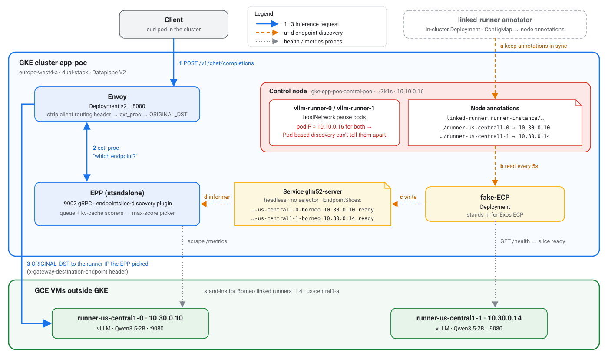
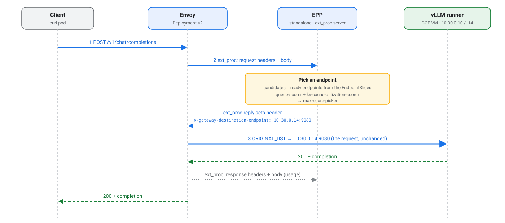

# Exos EPP + Envoy GKE PoC: Topology and Manifests

**Status:** PoC working end to end (2026-11-06); resources kept for inspection

**Owner:** xiyue

**Code:** plugin in [pkg/epp/framework/plugins/datalayer/discovery/endpointslice](../../pkg/epp/framework/plugins/datalayer/discovery/endpointslice/README.md); envtest PoC in [../poc](../poc); fake-ECP in [../fakeecp](../fakeecp).

## 1. Goal

Validate the EndpointSlice custom discovery plugin on a real GKE cluster:

*   Model servers run outside the cluster on GCE VMs, standing in for Borneo Ti-VM linked runners. Their hostNetwork pods in Kubernetes report the control node IP as podIP, so Pod-based discovery cannot work.
*   fake-ECP runs in the cluster and publishes each runner's real IP as an EndpointSlice of a selector-less headless Service.
*   A standalone EPP discovers endpoints with the endpointslice-discovery plugin. A separately deployed Envoy asks the EPP which endpoint to use over ext\_proc, then connects straight to the VM with ORIGINAL\_DST.
*   Out of scope this round: mTLS, P/D disaggregation, IPv6 addresses (the infrastructure is already dual-stack; addresses are IPv4 for now).

## 2. Topology



### 2.1 Mapping to Exos

| Exos production | PoC | Notes |
| :--- | :--- | :--- |
| sglang-router Deployment (namespace prediction, with egress-envoy sidecar) | Envoy Deployment + standalone EPP Deployment | The router already runs on regular GKE nodes, so its replacement (Envoy + EPP) does too |
| sglang on Borneo GB300 Ti-VMs (linked runners) | vLLM in docker on GCE VMs (g2-standard-8 + 1×L4) | Outside the cluster; the L4s are not GKE nodes |
| Control node (CPU GKE node, criproxy) | The control-pool node, labeled exos-poc/control-node=true by its node pool | Node annotations stand in for the linked-runner controller's output |
| hostNetwork model pods (podIP = control node IP) | prediction/vllm-runner-0/1 pause pods | Only reproduce the problem; they carry no traffic |
| linked-runner.runner-instance/... node annotations | linked-runner-annotator, from the linked-runners ConfigMap that infra.sh annotate writes | JSON with NAME / STATUS / IP\_ADDRESS / PROVIDER\_ID |
| ECP writes EndpointSlices (ready hard-coded to true) | fake-ECP (ready derived from a /health probe) | Service glm52-server; slices named glm52-server-RUNNER-borneo |

### 2.2 Request path



### 2.3 Endpoint discovery path

1.  infra.sh annotate writes one entry per VM, carrying the VM's internal IP, into the linked-runners ConfigMap. The linked-runner-annotator keeps a matching linked-runner.runner-instance/RUNNER annotation on the control node, and re-applies it if the node is recreated.
2.  fake-ECP reconciles every 5s. It reads the annotations, ensures the selector-less headless Service glm52-server exists, and writes one EndpointSlice per runner with STATUS=RUNNING. It probes the VM's :9080/health and writes the result into conditions.ready. When an annotation disappears, it deletes the matching slice.
3.  The EPP's endpointslice-discovery plugin watches slices matching kubernetes.io/service-name=glm52-server with an informer. It skips ready=false and terminating endpoints, picks the port named http, and upserts each endpoint into the EPP datastore with ID namespace/service.hostname.
4.  The EPP scrapes vLLM /metrics from each endpoint for scoring.

## 3. Resource inventory (project xiyue-gke-dev-new)

| Resource | Name / value |
| :--- | :--- |
| VPC | epp-poc-net (ULA internal IPv6 fd20:b84:290b::/48) |
| Subnets | epp-poc-subnet (europe-west4, 10.10.0.0/20, cluster + control node); epp-poc-subnet-us-central1 (10.30.0.0/20, current runners); epp-poc-subnet-europe-west1 (10.20.0.0/20, unused); all IPV4\_IPV6 with internal IPv6 |
| Cloud NAT | epp-poc-router / epp-poc-nat, plus epp-poc-router-us-central1 / epp-poc-nat-us-central1 and the europe-west1 pair (VMs have no external IP; used for image and model pulls) |
| Firewall | epp-poc-to-runner (tcp:9080 from the pod CIDR and the three subnets); epp-poc-iap-ssh (tcp:22 from IAP) |
| GKE | epp-poc, zonal europe-west4-a, Standard, dual-stack, Dataplane V2; default-pool 2 × e2-standard-4; control-pool 1 × e2-standard-2 labeled exos-poc/control-node=true (node gke-epp-poc-control-pool-b9a0680f-7k1s, 10.10.0.16); maintenance exclusion epp-poc-freeze (no node upgrades for 60 days) |
| kubectl context | gke\_xiyue-gke-dev-new\_europe-west4-a\_epp-poc |
| Runner VMs (in use) | runner-us-central1-0 (10.30.0.10, on-demand) and runner-us-central1-1 (10.30.0.14, spot, restarted when preempted); g2-standard-8 + 1×L4, us-central1-a. L4 was stocked out in europe-west4-a/b/c and europe-west1 (both on-demand and spot), and europe-west6 is blocked by the project's location policy |
| Runner VMs (stopped, kept) | runner-0 / runner-1 (europe-west4-b), runner-a-0 / runner-a-1 (europe-west4-a) |
| linked-runner stand-in | ConfigMap linked-runners (one entry per runner, written by infra.sh annotate) + Deployment linked-runner-annotator, which keeps the control node's annotations in sync every 15s |
| VM image | deeplearning-platform-release / common-cu129-ubuntu-2204-nvidia-580, 200GB disk |
| Model server | vllm/vllm-openai:latest (v0.33.0), Qwen/Qwen3.5-2B, host :9080 → container :8000 |
| EPP image | us-west1-docker.pkg.dev/xiyue-gke-dev-new/xiyue-poc/vertex-exos-poc/epp:custom-discovery |
| fake-ECP image | us-west1-docker.pkg.dev/xiyue-gke-dev-new/xiyue-poc/vertex-exos-poc/fake-ecp:latest |
| Envoy image | envoyproxy/envoy:v1.36.2 |

## 4. Verification results

verify.sh: 4/4 PASS (2026-11-06 with the europe-west4 runners; again 2026-11-09 with the us-central1 runners).

Results of the 2026-11-06 run (the 2026-11-09 run is the same with control node 10.10.0.16 and runners 10.30.0.10 / 10.30.0.14):

| Check | Result |
| :--- | :--- |
| Pod-based view | Control node IP 10.10.0.3; both model pods report podIP 10.10.0.3 (problem reproduced) |
| fake-ECP slices | glm52-server-runner-a-0-borneo → 10.10.0.10 ready=true; glm52-server-runner-a-1-borneo → 10.10.0.11 ready=true |
| EPP datastore | slice-discovery: totalEndpoints=2 (default/glm52-server.runner-a-0, default/glm52-server.runner-a-1) |
| Requests | 20 /v1/chat/completions requests through Envoy, all 200 with real Qwen3.5-2B completions |
| Distribution | Envoy access log: 33 requests each to upstream 10.10.0.10:9080 and 10.10.0.11:9080 |

Dynamic behavior also observed: after switching the annotations from runner-0/1 to runner-a-0/1, fake-ECP deleted the old slices and created new ones (ready=false at first, flipping to true once vLLM came up). The EPP picked up the new endpoint set without a restart.

### 4.1 Failure and security tests (2026-11-09)

Run with the two runners in us-central1-a. Load came from the in-cluster curl pod; each run was tagged with a query parameter so its Envoy access-log lines could be counted exactly.

**Forged destination header (client sets `x-gateway-destination-endpoint`)**

| Test | Result |
| :--- | :--- |
| Forged → nonexistent 10.30.0.99:9080 | 20/20 200, all to the runner the EPP picked |
| Forged with mixed case and duplicate values | 20/20 200, all to the EPP's pick |
| Forged → the runner the EPP was *not* picking (10.30.0.10) | 20/20 went to 10.30.0.14, the EPP's pick |
| EPP unavailable (scaled to 0) | 10/10 500 with no upstream: fails closed, so a forged header cannot be used even then |

The EPP's ext\_proc reply overwrites a client-supplied value. As defense in depth, Envoy now also strips `x-gateway-destination-endpoint` and `x-gateway-destination-endpoint-served` with a `header_mutation` filter placed *before* ext\_proc (route-level `request_headers_to_remove` would run after ext\_proc and delete the EPP's own value). Re-test: 10/10 200 to the EPP's pick.

**Failures and dynamic changes**

| Test | Result |
| :--- | :--- |
| EPP scaled to 0, then back to 1 | Down: 10/10 500, nothing bypasses the EPP. Back: endpoints rediscovered from the slices 2s after Ready; 10/10 200 |
| EPP rolling restart under load (90s, ~3.3 req/s) | 290/293 200. 1×500 when the old pod's ext\_proc stream dropped (fail-closed); 2×503 attributed to the upstream keep-alive race below |
| fake-ECP scaled to 0 | Existing slices stay; 10/10 200 (readiness just stops updating) |
| Runner lost under load (real spot preemption of runner-us-central1-1 during a 240s run) | fake-ECP marked the slice `ready=false` at 21:41:25 (GCE logged the preemption at 21:41:31); the EPP dropped the endpoint and all later traffic went to the other runner. 690/692 200: 1 request in flight on the dying VM timed out, 1×503 from the keep-alive race |
| Runner comes back | Slice flips to `ready=true` when `/health` passes; traffic splits across both runners again |
| Add a runner via the linked-runners ConfigMap | New slice, EPP endpoints 1 → 2 after 55s; requests 200 |
| Change a runner's IP to a dead address | Slice address updated, `ready=false`, EPP removed it after 39s |
| Remove runners from the ConfigMap | Annotations and slices deleted after 69s |

The 39–69s for ConfigMap-driven changes is mostly the kubelet refreshing the mounted ConfigMap (up to ~60s), plus the annotator's 15s loop and fake-ECP's 5s loop. The EPP reacts within a second of a slice change.

**Upstream keep-alive race (found and fixed).** vLLM's server (uvicorn) closes idle keep-alive connections after 5s; Envoy occasionally sent a request on a connection the server was closing, which showed up as a 503 with an upstream host and a very short duration (about 1 in 300–700 requests). Setting `idle_timeout: 4s` on the ORIGINAL\_DST cluster closes them on the Envoy side first. After the fix: 819/819 200 (fast load plus requests spaced 4.5–6s apart to hit the idle window).

## 5. Differences from Exos production and known limitations

*   Address family: slices are IPv4; Exos uses Borneo IPv6. Next step is to point the annotations at the VMs' IPv6 addresses and add an IPv6 firewall rule.
*   No mTLS: in Exos the router's egress goes through an egress-envoy sidecar for mTLS. Not done this round.
*   No P/D: single-role vLLM only. P/D needs ECP to write llm-d.ai/role on the slices; otherwise decode-filter accepts endpoints without a role label.
*   Ready semantics: real ECP hard-codes ready=true; fake-ECP derives it from a /health probe. Production needs either ECP-side probing or EPP-side metrics/health handling.
*   Metrics: the EPP parses vLLM metric names by default. Exos with SGLang needs core-metrics-extractor defaultEngine: sglang or the llm-d.ai/engine-type label.
*   Spot runners are preempted often (after 4 minutes to 2 hours in these runs). A preempted runner's slice goes ready=false and traffic moves to the other runner (section 4.1).
*   Runners are in us-central1 while the cluster is in europe-west4 (L4 stockout), so requests cross regions; this adds latency but does not affect discovery or routing.
*   GKE auto-upgrade recreated the nodes once and wiped the control node's label and annotations, after which fake-ECP deleted every slice. The PoC now uses a dedicated node pool for the label, an annotator that re-applies annotations, Deployments for the placeholder pods, and a maintenance exclusion. Exos's linked-runner controller should be checked for the same exposure.
*   The control node runs no criproxy.

## 6. Reproduction

```bash
cd llm-d-inference-scheduler   # branch capri-xiyue/custom-discovery
export REG=us-west1-docker.pkg.dev/xiyue-gke-dev-new/xiyue-poc/vertex-exos-poc
export EPP_IMAGE=$REG/epp:custom-discovery
export FAKEECP_IMAGE=$REG/fake-ecp:latest

# 1. Images
docker build -t $EPP_IMAGE -f Dockerfile.epp . && docker push $EPP_IMAGE
docker build -t $FAKEECP_IMAGE -f exos/fakeecp/Dockerfile . && docker push $FAKEECP_IMAGE

# 2. Infrastructure + runner VMs (use spot / another zone if L4 is stocked out)
RUNNERS="runner-a-0 runner-a-1" RUNNER_ZONE=europe-west4-a \
  RUNNER_PROVISIONING=SPOT RUNNER_PROVISIONING_FLAGS="--instance-termination-action=STOP" \
  bash exos/gke-poc/infra.sh up
RUNNERS="runner-a-0 runner-a-1" RUNNER_ZONE=europe-west4-a bash exos/gke-poc/infra.sh annotate   # writes ConfigMap linked-runners

# 3. Deploy
kubectl apply -f exos/gke-poc/manifests/annotator.yaml
kubectl apply -f exos/gke-poc/manifests/placeholder-pods.yaml
envsubst < exos/gke-poc/manifests/fakeecp.yaml | kubectl apply -f -
envsubst < exos/gke-poc/manifests/epp.yaml | kubectl apply -f -
kubectl apply -f exos/gke-poc/manifests/envoy.yaml

# 4. Verify
bash exos/gke-poc/verify.sh
```

## 7. Files

| File | Purpose |
| :--- | :--- |
| [infra.sh](infra.sh) | VPC, subnet, NAT, firewall, GKE cluster with control-pool, maintenance exclusion, runner VMs; `annotate` writes the linked-runners ConfigMap |
| [vllm-startup.sh](vllm-startup.sh) | GCE startup script: NVIDIA driver, Docker, vLLM |
| [verify.sh](verify.sh) | The four checks in section 4 |
| [manifests/annotator.yaml](manifests/annotator.yaml) | linked-runner controller stand-in: ConfigMap → control-node annotations |
| [manifests/placeholder-pods.yaml](manifests/placeholder-pods.yaml) | hostNetwork pods on the control node (reproduce podIP = node IP) |
| [manifests/fakeecp.yaml](manifests/fakeecp.yaml) | fake-ECP Deployment + RBAC |
| [manifests/epp.yaml](manifests/epp.yaml) | Standalone EPP with the endpointslice-discovery plugin |
| [manifests/envoy.yaml](manifests/envoy.yaml) | Standalone Envoy: strip client routing headers, ext\_proc to EPP, ORIGINAL\_DST to the picked runner |
| [docs/](docs) | Diagram sources (SVG) |
| [../fakeecp](../fakeecp/main.go) | fake-ECP source |
